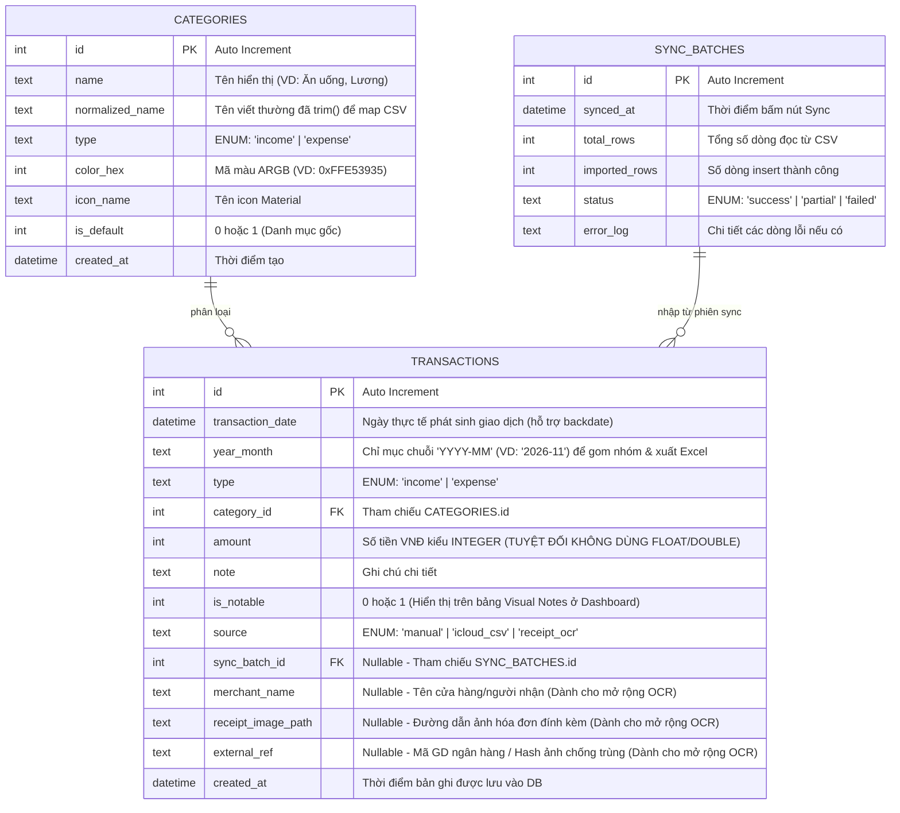

# Tài Liệu Đặc Tả Kỹ Thuật & Hướng Dẫn Triển Khai Dự Án: `m0n3y`
**Ứng Dụng Quản Lý Tài Chính Cá Nhân (Flutter Windows Desktop — Sprint Thực Chiến 2 Ngày)**

---

## 1. Bối cảnh Dự án & Yêu cầu Khách hàng (Business Brief)

Khách hàng cần một ứng dụng quản lý tài chính cá nhân chạy trực tiếp trên máy tính **Windows (`Windows Native Desktop`)** theo triết lý **Offline-first** (dữ liệu lưu cục bộ trên máy, tốc độ phản hồi tức thì, bảo mật tuyệt đối).

### Bài toán thực tế cần giải quyết:
1. **Khi đang đi ngoài đường**: Khách hàng dùng iPhone (thông qua **Apple Shortcuts**) để bấm nhập nhanh khoản thu/chi vừa phát sinh. Dữ liệu được nối tiếp (append) vào một file `pending_transactions.csv` nằm trong thư mục **iCloud Drive**.
2. **Khi ngồi trước máy tính Windows**:
   - Thư mục iCloud Drive đã tự đồng bộ file `pending_transactions.csv` về máy tính.
   - Khách hàng mở ứng dụng **`m0n3y`**, bấm nút **"Sync iCloud CSV"** $\rightarrow$ Ứng dụng đọc file CSV, chuẩn hóa dữ liệu, tự động xử lý các khoản nhập bù/lùi ngày (backdate), tự động tạo danh mục mới nếu chưa có, lưu toàn bộ vào cơ sở dữ liệu **SQLite**, sau đó **làm rỗng file CSV** để sẵn sàng cho đợt nhập tiếp theo.
   - Khách hàng theo dõi bức tranh tài chính trên giao diện **Màn hình ngang (Desktop Landscape)** gồm 3 khu vực: **Dashboard (Tổng quan & Ghi chú đáng chú ý)**, **Calendar View (Lịch thu chi theo tháng/ngày)**, và **Transactions (Bảng tra cứu, lọc & thêm/sửa/xóa giao dịch)**.
   - Khi cần lưu trữ hoặc gửi báo cáo, khách hàng bấm **"Export Excel"** $\rightarrow$ Ứng dụng xuất ra file `.xlsx`, tự động **chia từng Sheet theo từng Tháng-Năm (`MM-YYYY`)**.

```mermaid
flowchart LR
    subgraph iPhone["📱 iPhone (Apple Shortcuts)"]
        SC["Nhập nhanh Thu/Chi\n(Định dạng dd/MM/yyyy)"]
    end

    subgraph iCloud["☁️ iCloud Drive (Folder trên Windows)"]
        CSV["pending_transactions.csv"]
    end

    subgraph DesktopApp["💻 m0n3y Flutter Windows App"]
        SYNC["CsvSyncService\n(Parse dd/MM/yyyy, Auto-Category, Backdate)"]
        DB[("SQLite (Drift ORM)\nCategories | Transactions | SyncBatches")]
        RP["Riverpod Providers\n(Reactive Streams)"]
        UI["Desktop UI (NavigationRail)\nDashboard | Calendar | Transactions"]
        EX["ExcelExportService\n(Tách Sheets theo MM-YYYY)"]
    end

    SC -->|Append dòng mới| CSV
    CSV -->|1. Read & Validate| SYNC
    SYNC -->|2. Batch Insert (DB Transaction)| DB
    SYNC -->|3. Truncate file sau khi Commit| CSV
    DB --> RP
    RP --> UI
    DB --> EX
    EX -->|Xuất báo cáo| XLSX["m0n3y_report.xlsx"]
```

---

## 2. Quy định Tech Stack Bắt buộc & Hướng dẫn Cài đặt

> [!IMPORTANT]
> **Yêu cầu dành cho Team Phát triển**: Toàn bộ thành viên phải sử dụng thống nhất bộ thư viện dưới đây, tuyệt đối không tự ý dùng `setState` rời rạc cho dữ liệu toàn cục hoặc thao tác chuỗi SQL thủ công dễ gây lỗi SQL Injection / sai kiểu dữ liệu.

### 2.1. Danh mục Công nghệ & Lý do sử dụng

| Tầng (Layer) | Thư viện (Package) | Vai trò & Lý do bắt buộc sử dụng |
| :--- | :--- | :--- |
| **Platform** | **Flutter Windows Desktop** | Build ứng dụng Windows Native (`.exe`), tối ưu giao diện màn hình ngang (`min size: 1200x760`). |
| **State Management & DI** | `flutter_riverpod` | Quản lý state và Dependency Injection. Bắt buộc dùng `StreamProvider` / `AsyncNotifier` kết nối với Stream của SQLite để khi dữ liệu DB thay đổi (sau khi Sync hoặc Thêm/Sửa/Xóa), toàn bộ Dashboard, Lịch và Bảng tự động cập nhật mà không cần reload thủ công. |
| **Database (ORM)** | `drift` + `sqlite3_flutter_libs` + `path_provider` | ORM mạnh nhất cho SQLite trên Flutter. Kiểm tra kiểu dữ liệu lúc compile (type-safe), hỗ trợ `watch()` trả về `Stream` thời gian thực, hỗ trợ `transaction()` đảm bảo toàn vẹn dữ liệu khi Sync CSV. |
| **Charts & Visualization** | `fl_chart` | Vẽ biểu đồ cột/đường so sánh Thu - Chi và biểu đồ tròn (Pie/Donut Chart) cơ cấu chi tiêu theo danh mục trên Dashboard. |
| **CSV & Excel I/O** | `csv` + `excel` + `file_picker` | `csv`: Đọc chuẩn RFC-4180 (xử lý đúng các ghi chú có dấu phẩy bên trong ngoặc kép).<br>`excel`: Tạo file `.xlsx` nhiều Sheet theo `MM-YYYY`.<br>`file_picker`: Chọn file `pending_transactions.csv` và chọn nơi lưu file Excel. |
| **Window & Config** | `window_manager` + `shared_preferences` + `intl` | `window_manager`: Khóa kích thước cửa sổ tối thiểu `1200x760`.<br>`shared_preferences`: Lưu đường dẫn file CSV trên máy để không phải chọn lại mỗi lần mở app.<br>`intl`: Format tiền tệ VNĐ (`1.500.000 ₫`) và parse ngày `dd/MM/yyyy`. |

### 2.2. Lệnh khởi tạo Project & Cài đặt Dependencies (Dành cho nhóm trưởng chạy đầu tiên)

```powershell
# 1. Khởi tạo project chỉ bật nền tảng Windows
flutter create --platforms=windows m0n3y
cd m0n3y

# 2. Cài đặt các thư viện Runtime
flutter pub add flutter_riverpod drift sqlite3_flutter_libs path_provider path fl_chart csv excel file_picker shared_preferences window_manager intl

# 3. Cài đặt các thư viện Code Generation (Dev Dependencies)
flutter pub add --dev drift_dev build_runner

# 4. Lệnh sinh code tự động cho Drift Database (chạy mỗi khi sửa bảng DB)
dart run build_runner build --delete-conflicting-outputs
```

---

## 3. Các Quy tắc Nghiệp vụ Cốt lõi (Business Rules Đã Chốt)

> [!WARNING]
> **4 Quy tắc Nghiệp vụ phải tuân thủ chính xác 100% khi chấm nghiệm thu**:
> 1. **Định dạng ngày chuẩn (`dd/MM/yyyy`)**: Mọi dữ liệu ngày tháng hiển thị trên UI, đọc từ CSV, hay xuất ra Excel đều dùng chuẩn Việt Nam **`dd/MM/yyyy`** (ví dụ: `13/11/2026`). Bộ parser CSV ưu tiên parse `dd/MM/yyyy`, có hỗ trợ fallback `yyyy-MM-dd` để tránh crash nếu người dùng gõ nhầm.
> 2. **Xử lý Lùi ngày (Backdating)**: Khi người dùng nhập bù trên iPhone một khoản chi của ngày hôm trước (hoặc tháng trước), trường `transaction_date` phải lưu đúng ngày trên CSV, trong khi `created_at` lưu thời điểm bấm Sync. **Mọi biểu đồ, lịch, bộ lọc và Sheet Excel đều phải tính theo `transaction_date`**.
> 3. **Tự động tạo Danh mục mới khi Sync CSV**: Nếu tên danh mục trong CSV (ví dụ: `"Thú cưng"`) chưa tồn tại trong bảng `categories` (so sánh không phân biệt hoa/thường theo đúng nhóm `income`/`expense`), hệ thống **tự động tạo mới danh mục đó** với màu sắc & icon lấy từ bảng màu mặc định rồi gán vào giao dịch.
> 4. **Khu vực "Visual Notes" (Ghi chú đáng chú ý) trên Dashboard**: Kết hợp 2 điều kiện:
>    - **Tự động**: Hiển thị các giao dịch chi tiêu trong tháng có kèm ghi chú và có số tiền lớn nổi bật (`>= 500.000 ₫` hoặc Top chi tiêu lớn nhất tháng).
>    - **Thủ công / Ký hiệu**: Hiển thị mọi giao dịch được tích chọn `"Đáng chú ý"` (`is_notable = 1`) trên App, hoặc có tiền tố `*`, `!`, hay `#note` ở đầu nội dung Ghi chú khi nhập từ iPhone.

---

## 4. Thiết kế Cơ sở dữ liệu (Database Schema — SQLite / Drift)

Database gồm **3 bảng chính**: `categories`, `transactions`, và `sync_batches`.

> [!TIP]
> **Lưu ý thiết kế mở rộng**: Trong bảng `transactions`, chúng ta thiết kế sẵn 3 cột Nullable (`merchant_name`, `receipt_image_path`, `external_ref`) để chuẩn bị sẵn nền móng cho giai đoạn phát triển tiếp theo (Bóc tách hóa đơn bằng hình ảnh) mà không cần sửa lại bảng.

### 4.1. Sơ đồ Thực thể - Liên kết (ERD)



### 4.2. Các quy tắc bắt buộc khi code tầng Database (`lib/data/database/`)
1. **Kiểu dữ liệu tiền tệ (`amount`)**: Phải dùng `IntColumn` (số nguyên đơn vị VNĐ, ví dụ `65000`). Không dùng `RealColumn` để tránh lỗi làm tròn số dấu phẩy động khi cộng tổng hàng nghìn giao dịch.
2. **Trường dẫn xuất `year_month`**: Mỗi khi Insert hoặc Update `transaction_date`, phải tự động tính `year_month = "${date.year}-${date.month.toString().padLeft(2, '0')}"` (ví dụ: `"2026-11"`).
3. **Seed Data (Dữ liệu danh mục mặc định lần đầu mở App)**:
   - **Chi (`expense`)**: `Ăn uống`, `Di chuyển`, `Mua sắm`, `Hóa đơn & Tiện ích`, `Nhà cửa`, `Giải trí`, `Sức khỏe`, `Giáo dục`, `Khác`.
   - **Thu (`income`)**: `Lương`, `Thưởng`, `Đầu tư`, `Thu nhập phụ`, `Khác`.
4. **Chỉ mục (Indexes)**:
   - `UNIQUE(normalized_name, type)` trên bảng `categories` để không bao giờ bị trùng 2 danh mục cùng tên trong cùng nhóm Thu hoặc Chi.
   - Index trên `(transaction_date DESC)` và `(year_month, type)` của bảng `transactions`.

---

## 5. Kiến trúc Thư mục Chuẩn (Clean Feature-first + Riverpod)

Cấu trúc này được chia tách rõ ràng để **3 lập trình viên có thể code song song trên 3 thư mục khác nhau mà không bị xung đột (Git Conflict)**:

```text
lib/
├── main.dart                                 # Khởi tạo WindowManager (min 1200x760) & ProviderScope
├── app.dart                                  # MaterialApp, Theme Desktop
│
├── core/                                     # [DÙNG CHUNG] Hằng số, Formatters & Khung Layout
│   ├── constants/
│   │   ├── app_colors.dart                   # Màu ngữ nghĩa: Thu (Xanh lá), Chi (Đỏ/Cam), Surface
│   │   └── default_categories.dart           # Danh sách Seed Categories mặc định
│   ├── theme/
│   │   └── app_theme.dart                    # Thiết kế Card, Table, NavigationRail cho Desktop
│   ├── utils/
│   │   ├── currency_formatter.dart           # Format số nguyên -> "1.250.000 ₫"
│   │   └── date_parser.dart                  # Parse & Format chuẩn "dd/MM/yyyy"
│   └── widgets/
│       ├── desktop_shell.dart                # Khung màn hình ngang: NavigationRail (Trái) + Body (Phải)
│       └── top_action_bar.dart               # Thanh Header: Nút "Sync iCloud CSV", "Export Excel", "+ Thêm giao dịch"
│
├── data/                                     # [NHÁNH 1 PHỤ TRÁCH] Database & Repositories
│   ├── database/
│   │   ├── app_database.dart                 # Khai báo Drift Tables, Migrations & Seed Data
│   │   ├── app_database.g.dart               # File tự sinh bởi build_runner
│   │   └── daos/
│   │       ├── transactions_dao.dart         # CRUD, Stream lọc giao dịch, Stream gom nhóm theo tháng/ngày
│   │       └── categories_dao.dart           # Truy vấn danh mục & hàm getOrCreateByName()
│   └── repositories/
│       ├── transaction_repository.dart       # Cung cấp hàm nghiệp vụ & Stream cho UI Providers
│       └── settings_repository.dart          # Lưu đường dẫn file CSV vào SharedPreferences
│
└── features/
    ├── icloud_sync/                          # [NHÁNH 1 PHỤ TRÁCH] Đồng bộ CSV từ iCloud Drive
    │   ├── domain/
    │   │   ├── csv_raw_row.dart              # Model 1 dòng CSV + trạng thái Validate
    │   │   └── sync_result.dart              # Kết quả trả về sau khi Sync (số dòng thành công, danh mục mới tạo, lỗi)
    │   ├── services/
    │   │   └── csv_sync_service.dart         # Thuật toán đọc CSV, backdate, auto-category, commit DB & xóa trắng file
    │   └── providers/
    │       └── sync_controller.dart          # AsyncNotifier điều khiển nút Sync & hiển thị SnackBar/Dialog kết quả
    │
    ├── excel_export/                         # [NHÁNH 1 PHỤ TRÁCH] Xuất báo cáo Excel (.xlsx)
    │   ├── services/
    │   │   └── excel_export_service.dart     # Gom nhóm theo year_month, tạo từng Sheet "MM-YYYY"
    │   └── providers/
    │       └── export_controller.dart        # AsyncNotifier chọn đường dẫn lưu & xuất file
    │
    ├── transactions/                         # [NHÁNH 2 PHỤ TRÁCH] Màn hình Lịch sử & Quản lý Giao dịch
    │   ├── domain/
    │   │   └── transaction_filter.dart       # Model bộ lọc: Khoảng ngày, CategoryId, Loại Thu/Chi, Từ khóa
    │   ├── providers/
    │   │   └── transactions_provider.dart    # Quản lý state bộ lọc & Stream danh sách giao dịch
    │   └── presentation/
    │       ├── transactions_screen.dart      # Bảng dữ liệu Desktop (DataTable / ListView tối ưu)
    │       └── widgets/
    │           ├── transaction_filter_bar.dart # Thanh công cụ lọc đa chiều
    │           └── transaction_form_dialog.dart # Hộp thoại Thêm / Sửa / Xóa giao dịch
    │
    ├── calendar_view/                        # [NHÁNH 2 PHỤ TRÁCH] Màn hình Lịch chi tiêu (Calendar View)
    │   ├── domain/
    │   │   └── daily_cashflow.dart           # Model tổng Thu, tổng Chi, danh sách giao dịch của từng ngày
    │   ├── providers/
    │   │   └── calendar_provider.dart        # State: Tháng đang xem, Ngày đang chọn + Stream dữ liệu tháng
    │   └── presentation/
    │       ├── calendar_screen.dart          # Bố cục 2 Panel ngang: Lưới Lịch (65% Trái) + Chi tiết Ngày (35% Phải)
    │       └── widgets/
    │           ├── month_calendar_grid.dart  # Ô ngày hiển thị chấm màu + tổng Thu (+X) / tổng Chi (-Y)
    │           └── day_transactions_panel.dart # Danh sách chi tiết các khoản thu/chi + ghi chú của ngày được click
    │
    └── dashboard/                            # [NHÁNH 3 PHỤ TRÁCH] Màn hình Tổng quan (Dashboard)
        ├── domain/
        │   └── dashboard_summary.dart        # Model: Tổng thu, Tổng chi, Số dư, Dữ liệu Chart, Danh sách Visual Notes
        ├── providers/
        │   └── dashboard_provider.dart       # Riverpod Provider tổng hợp dữ liệu theo tháng/năm đang chọn
        └── presentation/
            ├── dashboard_screen.dart         # Bố cục Grid 12 cột cho màn hình rộng
            └── widgets/
                ├── balance_kpi_cards.dart    # 3 Thẻ KPI lớn: Số dư, Tổng Thu tháng, Tổng Chi tháng
                ├── cashflow_chart_card.dart  # Biểu đồ cột Thu-Chi & PieChart cơ cấu Danh mục (fl_chart)
                └── visual_notes_board.dart   # Khu vực "Visual Notes" (Ghi chú đáng chú ý & khoản chi lớn)
```

---

## 6. Đặc tả Chi tiết Các Thuật toán Cốt lõi (Dành cho Lập trình viên)

### 6.1. Thuật toán Đồng bộ File CSV (`CsvSyncService`)
- **Định dạng file `pending_transactions.csv` chuẩn**:
  ```csv
  Ngày,Loại,Danh mục,Số tiền,Ghi chú
  13/11/2026,Chi,Ăn uống,65000,Phở bò buổi sáng
  10/11/2026,Chi,Mua sắm,1250000,"*Mua bàn phím cơ (nhập bù ngày 10/11)"
  28/10/2026,Thu,Thưởng,3000000,Thưởng dự án tháng 10 nhập muộn
  ```
- **Quy trình 5 bước bắt buộc**:
  1. **Kiểm tra file**: Đọc đường dẫn file CSV từ `SettingsRepository`. Nếu chưa cấu hình hoặc file không tồn tại, bật `FilePicker` cho người dùng chọn file `pending_transactions.csv` trong thư mục iCloud Drive rồi lưu đường dẫn lại.
  2. **Đọc & Bỏ qua Header**: Đọc nội dung file bằng bảng mã `UTF-8`. Dùng `CsvToListConverter()` tách dòng. Nếu dòng đầu tiên chứa chữ `"Ngày"` hoặc `"Date"` thì bỏ qua dòng Header.
  3. **Parse từng dòng & Chuẩn hóa**:
     - **Ngày (`Cột 0`)**: Dùng `DateFormat('dd/MM/yyyy').parseStrict(rawDate.trim())`. Gán vào `transaction_date`. Tạo `year_month = "YYYY-MM"`.
     - **Loại (`Cột 1`)**: Chuẩn hóa chữ thường: `"thu"` hoặc `"income"` $\rightarrow$ `'income'`; `"chi"` hoặc `"expense"` $\rightarrow$ `'expense'`.
     - **Danh mục (`Cột 2`)**: Gọi `categoriesDao.getOrCreateByName(name: rawCategory, type: type)`. Hàm này tìm theo `normalized_name = rawCategory.trim().toLowerCase()`. Nếu chưa có trong DB thì tự động `INSERT` danh mục mới và trả về `category_id`.
     - **Số tiền (`Cột 3`)**: Loại bỏ các ký tự không phải số (như dấu chấm, phẩy, chữ `đ`, `k` nếu có) rồi `int.parse()`. Yêu cầu `amount > 0`.
     - **Ghi chú & Cờ Đáng chú ý (`Cột 4`)**:
       - Nếu ghi chú bắt đầu bằng `*`, `!` hoặc có chứa `#note`, hoặc là khoản chi có `amount >= 500000` (500.000 ₫) và có nội dung ghi chú $\rightarrow$ Gán `is_notable = 1` (đồng thời cắt bỏ dấu `*` ở đầu chuỗi để hiển thị sạch đẹp).
  4. **Ghi Database trong 1 Transaction duy nhất**:
     - Dùng `db.transaction(() async { ... })` để Insert bản ghi vào `sync_batches` và Insert hàng loạt vào `transactions`.
  5. **Làm rỗng file CSV an toàn**:
     - Sau khi `db.transaction` thành công, ghi đè file `pending_transactions.csv` về trạng thái chỉ còn dòng Header `Ngày,Loại,Danh mục,Số tiền,Ghi chú\n` (hoặc giữ lại những dòng bị lỗi sai định dạng số/ngày để người dùng kiểm tra, và báo cáo số dòng thành công/lỗi lên màn hình).

### 6.2. Thuật toán Xuất Báo cáo Excel Chia Sheet theo Tháng (`ExcelExportService`)
1. Truy vấn toàn bộ giao dịch (Join với bảng `categories` để lấy tên danh mục), sắp xếp theo `transaction_date ASC, id ASC`.
2. Gom nhóm (`groupBy`) danh sách giao dịch theo tháng-năm định dạng **`MM-YYYY`** dựa trên `transaction_date` (ví dụ: `"10-2026"`, `"11-2026"`).
3. Khởi tạo đối tượng `Excel.createExcel()`. Với mỗi nhóm `MM-YYYY`, tạo một Sheet mang tên `MM-YYYY`:
   - **Dòng 1**: Tiêu đề `BÁO CÁO THU CHI THÁNG MM/YYYY` (In đậm).
   - **Dòng 2**: Tóm tắt: `Tổng Thu: [X] VNĐ | Tổng Chi: [Y] VNĐ | Chênh lệch (Dư): [X - Y] VNĐ`.
   - **Dòng 4 (Header bảng)**: `STT | Ngày (dd/MM/yyyy) | Loại | Danh mục | Số tiền (VNĐ) | Ghi chú | Đáng chú ý`.
   - **Dòng 5 trở đi**: Đổ dữ liệu từng giao dịch trong tháng đó. Cột Số tiền phải ghi dưới dạng `IntCellValue(tx.amount)` để Excel hiểu là kiểu Số (có thể dùng hàm `SUM` trong Excel ngay lập tức).
4. Xóa Sheet mặc định (`Sheet1`) nếu thừa, mở hộp thoại chọn nơi lưu file và ghi ra đĩa.

---

## 7. Kế hoạch Phân công Thực chiến 2 Ngày cho Team 3 Người (48h Sprint)

Để 3 thành viên làm việc nhịp nhàng như một team dự án thực tế mà không chờ đợi hay đụng code nhau, hãy tuân thủ quy trình dưới đây:

### ⏱️ Giờ 01 – Giờ 02 (Sáng Ngày 1): Khởi tạo & Chốt Hợp đồng Dữ liệu (Làm chung)
- Nhóm trưởng khởi tạo Git repo, cài toàn bộ packages ở **Mục 2.2**.
- Cùng tạo khung thư mục ở **Mục 5** và chốt tên các Model/Entity cơ bản.
- Tạo bộ **Mock Data / Seed Transactions** (khoảng 20-30 giao dịch mẫu trải dài qua 2 tháng `10/2026` và `11/2026`) để Thành viên #2 và #3 có dữ liệu hiển thị lên UI ngay lập tức mà không phải chờ tính năng Sync CSV hoàn tất.

### 👨‍💻 Phân công độc lập theo 3 Nhánh (Từ Giờ 03 Ngày 1 đến Chiều Ngày 2)

| Thành viên | Nhánh Git & Phạm vi File | Nhiệm vụ cụ thể | Tiêu chí Nghiệm thu (Definition of Done) |
| :--- | :--- | :--- | :--- |
| **Thành viên #1**<br>*(Data, Sync CSV & Excel)* | `feat/data-and-io`<br>- `lib/data/**`<br>- `lib/features/icloud_sync/**`<br>- `lib/features/excel_export/**` | 1. Xây dựng bảng Drift SQLite (`app_database.dart`), DAOs, Seed Categories.<br>2. Viết `CsvSyncService` đọc file CSV chuẩn `dd/MM/yyyy`, lùi ngày, tự tạo danh mục mới, làm rỗng file sau sync.<br>3. Viết `ExcelExportService` xuất file `.xlsx` chia Sheet theo `MM-YYYY`.<br>4. Viết Unit Test kiểm thử bộ đọc CSV & xuất Excel. | - Import thử 1 file CSV mẫu có cả ngày hôm nay, ngày tháng trước và danh mục mới $\rightarrow$ Vào DB đủ 100%, file CSV tự sạch.<br>- Xuất file Excel mở trên MS Excel thấy rõ từng tab `10-2026`, `11-2026`, cột tiền cộng `SUM` được. |
| **Thành viên #2**<br>*(Layout, Bảng Giao dịch & Lịch)* | `feat/transactions-calendar`<br>- `lib/core/widgets/**`<br>- `lib/features/transactions/**`<br>- `lib/features/calendar_view/**` | 1. Dựng `DesktopShell` (`NavigationRail` bên trái + `TopActionBar` bên trên).<br>2. Màn hình **Transactions**: Bảng danh sách giao dịch, thanh Filter (Khoảng ngày, Danh mục, Thu/Chi, Tìm kiếm ghi chú), Dialog Thêm/Sửa/Xóa giao dịch.<br>3. Màn hình **Calendar View**: Chia 2 panel (Lưới lịch tháng 65% bên trái hiện `+Thu / -Chi` từng ngày; Panel chi tiết ngày 35% bên phải). | - Lọc giao dịch theo ngày/danh mục/từ khóa phản hồi tức thì.<br>- Thêm/Sửa/Xóa giao dịch trên UI cập nhật ngay vào SQLite.<br>- Click vào bất kỳ ngày nào trên Lịch tháng sẽ hiện đúng danh sách các khoản thu/chi và ghi chú của ngày đó ở cột bên phải. |
| **Thành viên #3**<br>*(Dashboard, Biểu đồ & Visual Notes)* | `feat/dashboard-settings`<br>- `lib/core/theme/**`<br>- `lib/core/utils/**`<br>- `lib/features/dashboard/**` | 1. Thiết kế `AppTheme` chuẩn Desktop hiện đại, rõ ràng, dễ nhìn.<br>2. Màn hình **Dashboard**: 3 thẻ KPI (Tổng số dư, Thu tháng, Chi tháng) có bộ chọn chuyển tháng.<br>3. Biểu đồ `fl_chart`: Biểu đồ cột Thu-Chi và PieChart tỷ trọng danh mục chi tiêu.<br>4. Khu vực **Visual Notes**: Hiển thị đẹp mắt các khoản chi tiêu lớn kèm ghi chú và các ghi chú được gắn dấu `*`.<br>5. Dialog cấu hình đường dẫn file CSV iCloud. | - Khi bấm Sync CSV hoặc thêm giao dịch mới, 3 thẻ KPI, Biểu đồ `fl_chart` và bảng **Visual Notes** tự động nhảy số ngay lập tức.<br>- Bảng Visual Notes hiển thị nổi bật lý do các khoản chi lớn hoặc các ghi chú quan trọng trong tháng. |

---

## 8. Định hướng Phát triển Dài hạn (Post-MVP Backlog — Lưu trữ cho Giai đoạn 2)

> [!NOTE]
> *Mục này dùng để lưu lại định hướng mở rộng sau khi hoàn thành 2 ngày phát triển bản MVP. Trong 2 ngày đầu, team chỉ cần đảm bảo đã tạo sẵn 3 cột dự phòng (`merchant_name`, `receipt_image_path`, `external_ref`) trong bảng `transactions` như ở Mục 4.1.*

### Tính năng Mục tiêu Giai đoạn 2: Bóc tách & Chuẩn hóa Ảnh Hóa Đơn / Chuyển Khoản từ Điện thoại (Smart Receipt Image-to-DB Pipeline)

Thay vì chỉ nhập chữ qua Apple Shortcuts, ở giai đoạn tiếp theo hệ thống sẽ cho phép người dùng **ném trực tiếp ảnh chụp hóa đơn giấy (siêu thị, cafe, ăn uống) hoặc ảnh chụp màn hình chuyển khoản ngân hàng (Vietcombank, Techcombank, MB, MoMo...) từ điện thoại lên** để hệ thống tự động bóc tách, chuẩn hóa và đẩy vào Database:

1. **Cơ chế gửi ảnh từ Điện thoại lên (Image Ingestion)**:
   - Người dùng chọn 1 hoặc nhiều ảnh hóa đơn / màn hình chuyển khoản trên điện thoại $\rightarrow$ Ném vào thư mục đồng bộ (ví dụ: `iCloud Drive/m0n3y/inbox_images/`) hoặc đẩy qua một hàng đợi Cloud Staging / Bot trung gian.
2. **Động cơ Bóc tách & Chuẩn hóa tự động (Extraction & Normalization Engine)**:
   - **Bóc tách (AI Vision / OCR)**: Đọc ảnh để lấy ra Số tiền thanh toán cuối cùng, Ngày giờ giao dịch trên hóa đơn, Tên cửa hàng / Người nhận tiền (`merchant_name`), Nội dung / Các món chính (`note`), và Mã giao dịch ngân hàng (`external_ref`).
   - **Chuẩn hóa Số tiền**: Tự động quy đổi mọi định dạng tiền trên ảnh (`"1.250.000 đ"`, `"1,250,000 VND"`, `"150k"`) về số nguyên `INTEGER` chuẩn (`1250000`).
   - **Chuẩn hóa Ngày tháng (Auto-Backdate theo ảnh)**: Tự động lấy ngày giờ in trên hóa đơn/biên lai chuyển khoản quy về chuẩn `dd/MM/yyyy` để gán vào `transaction_date` (dù cuối tuần mới gom 20 ảnh ném lên cùng lúc thì hệ thống vẫn tự xếp đúng từng khoản chi về đúng ngày thực tế trong quá khứ).
   - **Chuẩn hóa & Tự học Danh mục (`Merchant-to-Category Mapping`)**: Dựa vào `merchant_name` hoặc nội dung chuyển khoản (VD: `"Highlands"`, `"WinMart"`, `"Grab"`, `"Điện lực"`) để tự động gán vào đúng `category_id` trong Database.
   - **Chống trùng lặp tại Database**: Đối chiếu `external_ref` (mã giao dịch ngân hàng / mã băm SHA-256 của ảnh) và cặp `(transaction_date, amount)` để phát hiện nếu hóa đơn đó đã được quét hoặc đã nhập tay trước đó.
3. **Lưu trữ & Đối soát trong Database**:
   - Đẩy bản ghi đã chuẩn hóa vào bảng `transactions` với `source = 'receipt_ocr'` kèm đường dẫn ảnh hóa đơn đã nén (`receipt_image_path`) để khi click vào giao dịch trên Desktop có thể mở xem lại ảnh chứng từ gốc.
   - Hỗ trợ chế độ **Duyệt nhanh (Split-View Review)** cho những hóa đơn bị mờ hoặc độ tin cậy thấp trước khi chốt sổ.
