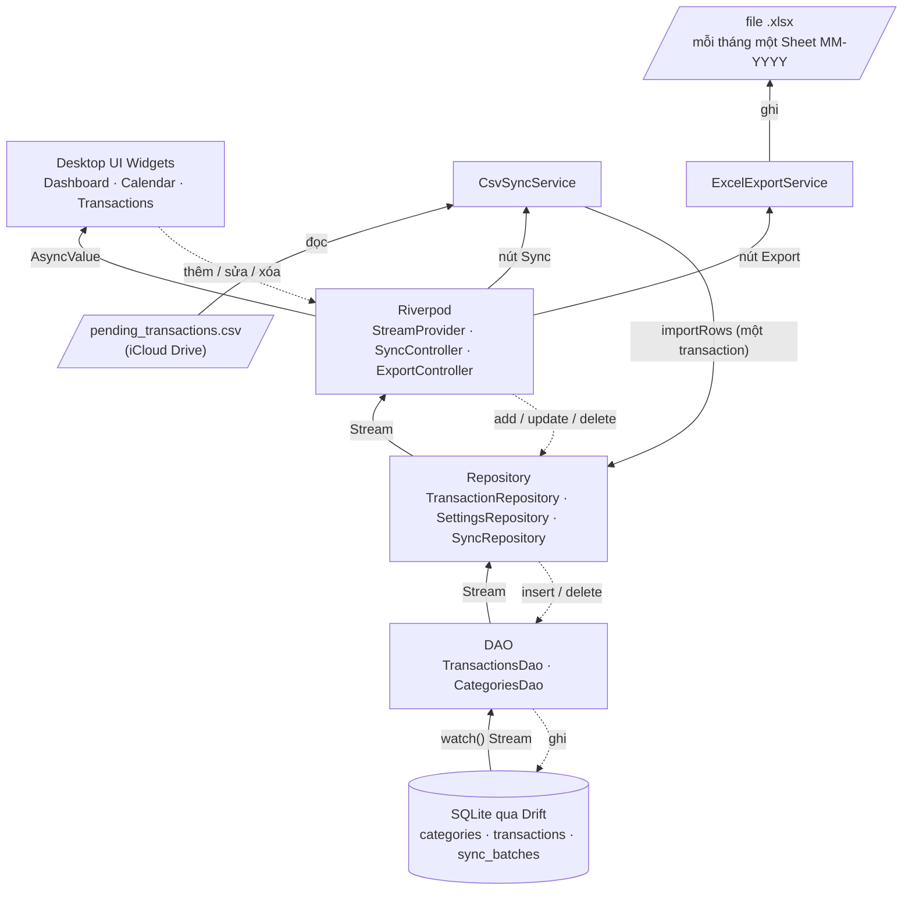
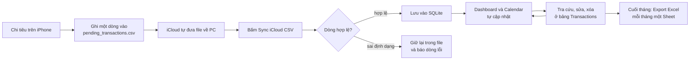
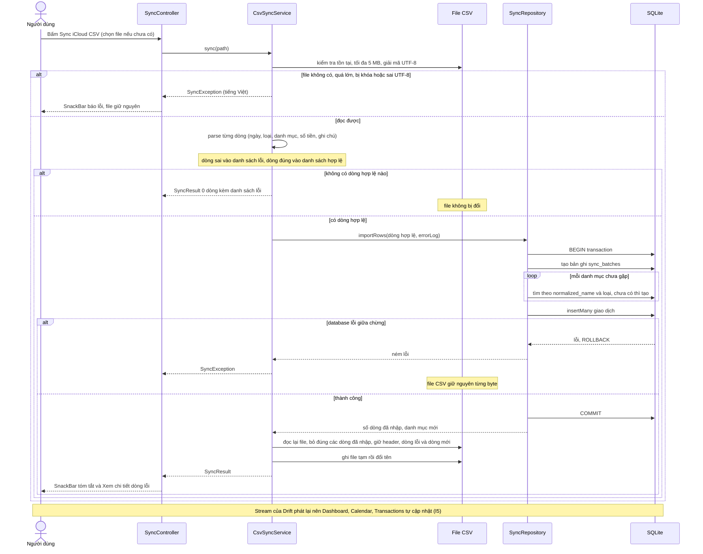

<div align="center">

# 💰 `m0n3y` — Quản Lý Tài Chính Cá Nhân (Windows Desktop)

**Dự án Thực chiến Phát triển Sản phẩm với AI Agents (48h Product Sprint)**  
*Hệ thống quản lý thu chi Offline-first trên Windows Desktop kết hợp đồng bộ nhanh từ iPhone qua iCloud Drive*

<p>
  
  
  
  
  
</p>

</div>

---

## 1. Giới thiệu & Bối cảnh Dự án

Repository này được thiết lập bởi **Hà Tiến Triệu ([@trieuwu](https://github.com/trieuwu))** với vai trò **Khách hàng (Project Sponsor) & Người hướng dẫn (Tech Mentor)**.

Đây là bài tập thực chiến kéo dài **2 ngày (48 giờ)** dành cho đội ngũ 3 thành viên nhằm rèn luyện đồng thời hai năng lực cốt lõi:
1. **Làm chủ quy trình điều phối AI Agents** (Claude Code, Antigravity, Cursor...) để xây dựng phần mềm có kỷ luật kiến trúc, không phụ thuộc mù quáng vào AI.
2. **Trải nghiệm quy trình phát triển sản phẩm thực tế với khách hàng**: từ đọc hiểu đặc tả, tự tổ chức đội ngũ theo mô hình **PO – Dev – Tester**, quản lý nhánh Git trực tiếp trên repository gốc, thiết kế luồng hệ thống, đảm bảo bảo mật/toàn vẹn dữ liệu cho đến bàn giao nghiệm thu.

### Tài liệu Dự án (Bắt buộc đọc kỹ trước khi code)

| Tài liệu | Mục đích |
| :--- | :--- |
| [**`REQUIREMENTS.md`**](REQUIREMENTS.md) | **Đề bài & Quy chế làm việc**: Quy định về vai trò (PO, Dev, Tester), quy trình Git & nhánh trên repo gốc, kỷ luật dùng AI Agents, yêu cầu tự định hướng MVP, vẽ sơ đồ luồng xử lý, tiêu chuẩn bảo mật và tiêu chí nghiệm thu. |
| [**`IMPLEMENTATION_PLAN.md`**](IMPLEMENTATION_PLAN.md) | **Đặc tả kỹ thuật & Hướng dẫn triển khai**: Yêu cầu nghiệp vụ của khách hàng, Tech Stack bắt buộc, lược đồ SQLite (Drift), cấu trúc thư mục và gợi ý chia việc trong 2 ngày. |
| [**`.github/pull_request_template.md`**](.github/pull_request_template.md) | Mẫu Pull Request bắt buộc phải điền đầy đủ mỗi khi tạo PR gộp code. |

---

## 2. Đội ngũ Phát triển & Phân công Vai trò

> **Hướng dẫn cho nhóm**: Trong Pull Request đầu tiên (`docs/cap-nhat-thong-tin-nhom`), 3 thành viên tự thảo luận để nhận 3 vai trò điều phối (**PO**, **Dev**, **Tester**) và điền đầy đủ thông tin vào bảng dưới đây.
>
> ⚠️ **QUY TẮC BẮT BUỘC ("100% Hands-on Coding")**: Việc chia role `PO` – `Dev` – `Tester` là để phân rõ trách nhiệm đầu mối (ai chốt nghiệp vụ, ai gác cổng kiến trúc, ai gác cổng chất lượng), **TUYỆT ĐỐI KHÔNG CÓ NGHĨA LÀ PO HAY TESTER CHỈ NGỒI VIẾT TÀI LIỆU / CHỜ TEST**. Cả 3 thành viên đều là **Core Developers**, mỗi người bắt buộc phải trực tiếp cầm 1 trong 3 nhánh code chính (~33% khối lượng code ứng dụng) và dùng AI Agents đẩy tốc độ phát triển lên tối đa! Khi chấm điểm sẽ kiểm tra `git log` đóng góp code thực tế của cả 3 người.

| Vai trò (Role) | Họ và Tên | GitHub | Nhánh làm việc chính | Phân hệ kỹ thuật phụ trách |
| :--- | :--- | :--- | :--- | :--- |
| **Project Sponsor / Mentor** | Hà Tiến Triệu | [@trieuwu](https://github.com/trieuwu) | `main` | Thiết lập bài toán, review kiến trúc & nghiệm thu sản phẩm |
| **PO (Product Owner)** | Nguyễn Tú Anh | [@nguyentuanh-fw](https://github.com/nguyentuanh-fw) | `feat/dashboard-va-bieu-do` | Quản lý phạm vi MVP, luồng nghiệp vụ, tài liệu hóa & phân hệ Dashboard, biểu đồ, theme (`lib/features/dashboard/`, `lib/core/theme/`, `lib/core/utils/`) |
| **Dev (Lead Developer)** | Phùng Hải Đăng | [@TemuBroCode](https://github.com/TemuBroCode) | `feat/dong-bo-csv-va-excel` | Kiến trúc cốt lõi, Database/Core Services, review tích hợp & phân hệ Database, đồng bộ CSV iCloud, xuất Excel (`lib/data/`, `lib/features/icloud_sync/`, `lib/features/excel_export/`) |
| **Tester (QA / QC Lead)** | Đàm Thuận Khải | [@tkai-better](https://github.com/tkai-better) | `feat/giao-dich-va-lich` | Thiết kế Test Cases, kiểm thử biên/bảo mật, CI/Test tự động & phân hệ khung ứng dụng, Giao dịch, Lịch chi tiêu (`lib/core/widgets/`, `lib/features/transactions/`, `lib/features/calendar_view/`) |

---

## 3. Định hướng MVP & Trạng thái Tính năng

> **Hướng dẫn cho nhóm**: Cập nhật trạng thái thực tế của từng hạng mục trong quá trình phát triển theo 3 nhãn:
> - **`ĐÃ CÓ`**: Đã chạy ổn định và có kiểm thử trên nhánh `develop` / `main`.
> - **`SẼ LÀM`**: Nằm trong phạm vi cam kết của MVP 2 ngày và đang triển khai.
> - **`HƯỚNG`**: Định hướng mở rộng sau MVP (Post-MVP Phase 2), đã chuẩn bị sẵn nền móng trong thiết kế.

| Hạng mục / Tính năng | Mô tả & Bất biến kỹ thuật | Trạng thái |
| :--- | :--- | :---: |
| **Tầng Cơ sở dữ liệu SQLite (Drift ORM)** | Lưu trữ `categories`, `transactions`, `sync_batches`. Tiền tệ bắt buộc lưu kiểu `INTEGER` (VNĐ) để không sai số dấu phẩy động. | `ĐÃ CÓ` |
| **Đồng bộ CSV từ iCloud Drive (`CsvSyncService`)** | Đọc `pending_transactions.csv` chuẩn ngày `dd/MM/yyyy`, hỗ trợ lùi ngày (`transaction_date`), tự tạo danh mục mới, xóa trắng file an toàn sau khi commit DB. Đường dẫn file xem và đổi được qua hộp thoại "Cấu hình file CSV" trên Dashboard. Phần logic đã xong và có test; nút "Sync iCloud CSV" trên `TopActionBar` chưa được nối (`lib/app.dart` chưa truyền `onSyncCsv`). | `ĐÃ CÓ` |
| **Màn hình Tổng quan (`Dashboard`)** | Bộ chọn tháng; 3 thẻ KPI (Số dư lũy kế đến hết tháng đang xem, Thu tháng, Chi tháng); biểu đồ cột Thu–Chi 6 tháng và PieChart cơ cấu chi theo danh mục (`fl_chart`); bảng **Visual Notes** (khoản chi từ 500.000 ₫ có ghi chú, hoặc giao dịch đánh dấu `*`, `!`, `#note`, "Đáng chú ý"). | `ĐÃ CÓ` |
| **Màn hình Lịch chi tiêu (`Calendar View`)** | Bố cục 2 panel màn hình ngang: Lưới lịch tháng bên trái hiển thị `+Thu / -Chi` từng ngày + Panel chi tiết giao dịch của ngày đang chọn bên phải. | `ĐÃ CÓ` |
| **Màn hình Quản lý Giao dịch (`Transactions`)** | Bảng dữ liệu Desktop, bộ lọc đa chiều (khoảng ngày tự đảo khi chọn ngược, danh mục, loại thu/chi, từ khóa ghi chú) và hộp thoại Thêm / Sửa / Xóa giao dịch. | `ĐÃ CÓ` |
| **Xuất Báo cáo Excel (`ExcelExportService`)** | Xuất file `.xlsx` tự động tách từng Sheet theo tháng (`MM-YYYY`), có tổng kết Thu - Chi - Dư và chống lỗi CSV/Formula Injection. Phần logic đã xong và có test; nút "Xuất Excel" trên `TopActionBar` chưa được nối (`lib/app.dart` chưa truyền `onExportExcel`). | `ĐÃ CÓ` |
| **Bóc tách Ảnh Hóa đơn từ Điện thoại (OCR/Vision)** | Ném ảnh hóa đơn / màn hình chuyển khoản từ điện thoại lên $\rightarrow$ bóc tách số tiền, ngày giờ, tên quán $\rightarrow$ chuẩn hóa & đẩy vào Database. | `HƯỚNG` |

---

## 4. Kiến trúc & Các Luồng Hệ thống (Do nhóm tự thiết kế & bổ sung)

> **Yêu cầu**: Nhóm phát triển tự vẽ và cập nhật các sơ đồ `mermaid` cùng thuyết minh kiến trúc vào khu vực này theo đúng yêu cầu tại Mục 4 của file [`REQUIREMENTS.md`](REQUIREMENTS.md).

### 4.1. Sơ đồ Kiến trúc Tổng thể
Dữ liệu đi một chiều: Drift phát lại Stream mỗi khi bảng đổi, các tầng chuyển nó lên đến Widget (đường liền); người dùng thao tác thì lệnh ghi đi xuống từng tầng (đường đứt). Widget không bao giờ chạm trực tiếp vào DAO hay database. `CsvSyncService` đọc file CSV rồi ghi vào database qua `SyncRepository`; `ExcelExportService` nhận dữ liệu từ `ExportController` (lấy qua Repository) và tạo file `.xlsx`.



### 4.2. Luồng Hoạt động Người dùng (User Flow) & Luồng Xử lý Dữ liệu (Data Sequence Flow)
**Hành trình người dùng, từ lúc chi tiêu trên iPhone đến báo cáo cuối tháng:**



**Luồng Sync CSV, kể cả khi gặp lỗi.** Điểm cốt lõi là thứ tự: file CSV chỉ được ghi lại sau khi database đã COMMIT.



Nếu database đã lưu xong nhưng file CSV bị khóa nên không dọn được, `SyncResult` mang một cảnh báo để người dùng xóa tay các dòng đã nhập, tránh nhập trùng.

### 4.3. Các Quyết định Kỹ thuật & Bảo mật (Technical Decisions & Security)
`<!-- Nhóm điền bảng các quyết định kỹ thuật, cách đảm bảo tính nguyên tử (Atomicity) khi đọc/xóa file CSV và các biện pháp bảo mật đã áp dụng -->`

| Quyết định kỹ thuật / Bảo mật | Lý do lựa chọn | Cách kiểm chứng |
| :--- | :--- | :--- |
| Tiền là `int` (VNĐ) ở database, model và mọi phép cộng trừ (I1) | Số thực gây sai số dấu phẩy động làm lệch tổng | `database_test.dart` (nhóm I1), `csv_sync_test.dart` (nhóm I1) |
| Ghi cả lô dòng CSV trong một `db.transaction` (`SyncRepository.importRows`) | Lỗi giữa chừng thì không còn giao dịch nào bị lưu nửa vời | `csv_sync_test.dart`: "DB lỗi → rollback, file CSV giữ nguyên từng byte" |
| Chỉ dọn file CSV sau khi COMMIT, giữ dòng lỗi, ghi file tạm rồi đổi tên (I2) | Không mất dữ liệu khi lỗi hoặc tắt máy giữa chừng, file không bao giờ ở trạng thái ghi dở | `csv_sync_test.dart` (nhóm I2) |
| Dọn file bằng cách đọc lại file rồi bỏ đúng các dòng đã nhập | iPhone có thể thêm dòng mới qua iCloud ngay lúc đang sync, không được xóa nhầm | `csv_sync_test.dart`: "dòng iPhone thêm vào giữa lúc sync không bị mất" |
| Mọi báo cáo, Sheet Excel tính theo `transaction_date`, không theo `created_at` (I3) | Khoản nhập bù cho tháng trước vẫn rơi đúng tháng | `database_test.dart` (nhóm I3), `acceptance_flow_test.dart` (giao dịch 28/10 vào Sheet `10-2026`) |
| Danh mục khớp qua `normalized_name` (viết thường, cắt khoảng trắng) cộng loại, ràng buộc duy nhất (I4) | "Ăn uống", "ăn uống " và "ĂN UỐNG" là cùng một danh mục, không tạo trùng | `database_test.dart` (nhóm I4), `csv_sync_test.dart` (nhóm I4) |
| Giao diện nhận dữ liệu qua `Stream` của Drift (`watch()`), không dùng `setState` cho dữ liệu toàn cục (I5) | Màn hình tự cập nhật sau sync, thêm, sửa, xóa, không cần khởi động lại | `database_test.dart` (nhóm I5); widget test `transactions_screen_test.dart`, `calendar_screen_test.dart`, `dashboard_screen_test.dart` (thêm/sửa/xóa xong màn hình đổi ngay) |
| Biểu đồ `fl_chart` cần số `double`: chỉ gọi `toDouble()` đúng lúc đưa vào biểu đồ để vẽ; tổng tiền, số dư và phần trăm vẫn tính bằng `int` (I1) | Thư viện vẽ dùng số thực, nhưng mọi con số hiển thị phải chính xác tuyệt đối | `dashboard_provider_test.dart` (tổng tháng, số dư lũy kế, cơ cấu chi); SUM chạy trong SQLite trên cột INTEGER |
| Thẻ "Số dư" là số dư lũy kế đến hết tháng đang xem (`watchTotalsUntil`), lọc theo `year_month` (I3) | Lùi về tháng cũ thì thấy đúng số dư tại thời điểm đó, khoản nhập bù vẫn tính đúng tháng | `database_test.dart` ("số dư lũy kế…"), `dashboard_provider_test.dart` |
| Chống Formula Injection: chuỗi Ghi chú, Danh mục bắt đầu bằng `=`, `+`, `-`, `@`, tab hoặc CR thì thêm `'` ở đầu khi ghi Excel | Excel có thể chạy chuỗi đó như công thức | `excel_export_test.dart` (chống Formula Injection, `sanitize`), `acceptance_flow_test.dart` (`=SUM(A1)` thành `'=SUM(A1)`) |
| Giới hạn file CSV 5 MB, giải mã UTF-8 chặt, bắt lỗi file khóa hoặc không tồn tại và báo tiếng Việt | App không crash khi gặp file hỏng hoặc quá lớn | `csv_sync_test.dart` (nhóm "Lỗi file - báo tiếng Việt, không crash") |

---

## 5. Hướng dẫn Cài đặt & Chạy thử (Do nhóm hoàn thiện)

> **Yêu cầu**: Nhóm cập nhật chính xác từng câu lệnh để Khách hàng có thể clone repo về và chạy thử thành công chỉ trong vài bước.

**Chuẩn bị máy Windows (một lần):**
- Flutter SDK bản stable (nhóm dùng 3.50.1). Kiểm tra bằng `flutter doctor`: mục *Visual Studio - develop Windows apps* phải có dấu ✓.
- Visual Studio (bản Community là đủ) cài workload **Desktop development with C++**, gồm MSVC build tools x64/x86, C++ CMake tools for Windows và Windows 10/11 SDK. Thiếu workload này thì `flutter run -d windows` không build được.
- Bật **Developer Mode** trong Windows Settings (`start ms-settings:developers`). Flutter cần quyền tạo symlink để build các plugin.

```powershell
# 1. Cài đặt dependencies
flutter pub get

# 2. Sinh mã nguồn Drift Database (nếu cần)
dart run build_runner build --delete-conflicting-outputs

# 3. Kiểm tra định dạng, kiểm tra tĩnh & chạy bộ kiểm thử tự động
dart format --output=none --set-exit-if-changed .
flutter analyze
flutter test

# 4. Khởi chạy ứng dụng trên Windows Desktop
flutter run -d windows

# 4b. Chạy kèm dữ liệu mẫu (29 giao dịch tháng 10 và 11/2026) để xem ngay Dashboard, Lịch, Giao dịch
flutter run -d windows --dart-define=SEED_MOCK=true
```

Dữ liệu được lưu trong file `m0n3y.sqlite` ở thư mục dữ liệu ứng dụng của người dùng (AppData). Dữ liệu mẫu chỉ được nạp khi database còn trống.

---

## 6. Nhật ký Kiểm thử & Hạn chế Hiện tại (Do Tester & PO hoàn thiện)

### 6.1. Kết quả Kiểm thử
`<!-- Tester cập nhật danh sách các bài test đã vượt qua, các kịch bản biên (edge cases) đã test -->`

### 6.2. Hạn chế & Hướng Cải tiến
`<!-- Nhóm thẳng thắn ghi nhận các điểm còn hạn chế của bản MVP sau 2 ngày và đề xuất hướng xử lý -->`

---

## 7. Nhận xét & Nghiệm thu của Khách hàng / Mentor

<!-- KHU VỰC NÀY DÀNH RIÊNG CHO HÀ TIẾN TRIỆU (@trieuwu) — ĐỘI NGŨ PHÁT TRIỂN KHÔNG CHỈNH SỬA MỤC NÀY -->

- **Đánh giá Quy trình Git & Quản lý nhánh**: *(Chờ nghiệm thu)*
- **Đánh giá Kỹ năng Điều phối AI Agents & Chất lượng Code**: *(Chờ nghiệm thu)*
- **Đánh giá Sản phẩm Demo (MVP) & Xử lý tình huống biên/bảo mật**: *(Chờ nghiệm thu)*
