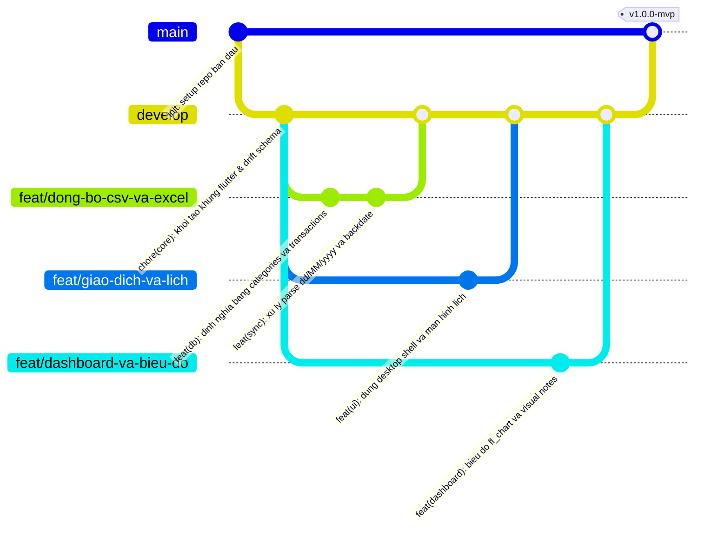

# Đề Bài, Quy Chế Kỹ Thuật & Hướng Dẫn Thực Chiến: Dự Án `m0n3y`

Chào mừng 3 bạn đến với đợt huấn luyện thực chiến phát triển sản phẩm cùng khách hàng.
Repository này do **Hà Tiến Triệu ([@trieuwu](https://github.com/trieuwu))** thiết lập. Các bạn sẽ **làm việc trực tiếp trên repository gốc này** trong vòng **2 ngày (48 giờ)** để biến bản đặc tả kỹ thuật tại [`IMPLEMENTATION_PLAN.md`](IMPLEMENTATION_PLAN.md) thành một ứng dụng Windows Desktop hoàn chỉnh, đồng thời hoàn thiện bộ tài liệu kiến trúc chuẩn chỉnh để bàn giao cho khách hàng.

Tài liệu này quy định chi tiết **cách tổ chức đội ngũ, kỷ luật dùng Git, phương pháp điều phối AI Agents, yêu cầu tự định hướng MVP, vẽ luồng hệ thống và tiêu chuẩn bảo mật**. Hãy đọc kỹ toàn bộ trước khi viết dòng code đầu tiên.

---

## 1. Tổ chức Đội ngũ & Mô hình 3 Vai trò (`PO` – `Dev` – `Tester` kiêm 100% Full-speed Coding)

Trong một dự án thực tế quy mô nhỏ (Small Agile Squad), không có chỗ cho người "chỉ ngồi chỉ tay năm ngón" hay "ngồi không chờ người khác code xong mới test".

> [!IMPORTANT]
> **Nguyên tắc "3 Mũi Nhọn Cùng Code — Tối Đa Tốc Độ"**:
> - **Mỗi thành viên đều gánh 2 chiếc mũ**: **(1) Một vai trò điều phối chéo (`PO` / `Dev` / `Tester`)** + **(2) Trực tiếp lập trình trọn vẹn 1/3 khối lượng code của sản phẩm**.
> - Với sự hỗ trợ của AI Agents, cả 3 người phải chạy song song ở tốc độ cao nhất ngay từ giờ đầu tiên. Ai làm xong phân hệ code của mình sớm phải lập tức nhảy sang hỗ trợ viết Unit/Widget Tests, tối ưu UI hoặc gỡ bug cùng đồng đội.
> - **Kiểm tra đóng góp công bằng**: Khi nghiệm thu, Khách hàng sẽ kiểm tra trực tiếp lịch sử `git log` trên các nhánh code (`lib/`, `test/`). Cả 3 thành viên đều phải có lượng commit code tính năng (`feat`, `fix`, `test`) thực chất; không chấp nhận bất kỳ ai chỉ có commit sửa file `.md`.

Trước khi bắt đầu, 3 bạn tự họp nhanh (15 phút) để nhận **3 vai trò điều phối + 3 phân hệ code** dưới đây và điền tên vào bảng trong [`README.md`](README.md):

| Vai trò & Phân hệ | Trách nhiệm Điều phối Chéo (20% thời gian) | Trách nhiệm Trực tiếp Lập trình — Hands-on Coding (80% thời gian) |
| :--- | :--- | :--- |
| **1. PO + Core Coder #3**<br>*(Product Owner & Dashboard/Analytics Dev)* | - Là đầu mối giao tiếp với Khách hàng (`@trieuwu`) để chốt nghiệp vụ và ưu tiên tính năng MVP (*Golden Path*).<br>- Tổng hợp tài liệu kiến trúc trên [`README.md`](README.md) và dẫn dắt kịch bản Demo. | - **Trực tiếp code toàn bộ phân hệ Dashboard & Cấu hình (`lib/features/dashboard/`, `lib/core/theme/`, `lib/core/utils/`)**:<br>  + 3 thẻ KPI số dư, Thu/Chi tháng + Bộ chọn tháng.<br>  + Biểu đồ dòng tiền & PieChart danh mục bằng `fl_chart`.<br>  + Bảng **Visual Notes** (tự động lọc chi tiêu lớn + ghi chú gắn dấu `*`).<br>  + Hộp thoại cấu hình đường dẫn file CSV iCloud. |
| **2. Dev + Core Coder #1**<br>*(Lead Architect & Data/I-O Engine Dev)* | - Khởi tạo project Flutter Windows, chốt **Database Schema & Interfaces** trong 2 giờ đầu để 2 bạn kia có chỗ bám vào code song song.<br>- Quản lý nhánh tích hợp (`develop`), xử lý conflict và thiết lập file quy tắc AI Agent (`CLAUDE.md`). | - **Trực tiếp code toàn bộ tầng Database & Đồng bộ I/O (`lib/data/`, `lib/features/icloud_sync/`, `lib/features/excel_export/`)**:<br>  + Thiết kế bảng Drift SQLite, DAOs, Seed Categories & Mock Data ban đầu.<br>  + Thuật toán `CsvSyncService` (đọc CSV `dd/MM/yyyy`, lùi ngày, tự tạo danh mục, xóa trắng file an toàn).<br>  + Thuật toán `ExcelExportService` (xuất `.xlsx` tách Sheet theo `MM-YYYY`, chống Formula Injection). |
| **3. Tester + Core Coder #2**<br>*(QA/Security Lead & Transactions/Calendar Dev)* | - Thiết kế bộ dữ liệu CSV mẫu (gồm cả dữ liệu chuẩn và dữ liệu bẫy/lỗi biên) để cả nhóm test.<br>- Soi code, chạy test và kiểm tra Checklist Bảo mật (Mục 5) trên mọi PR trước khi gộp vào `develop`. | - **Trực tiếp code toàn bộ Khung App, Bảng Giao dịch & Lịch chi tiêu (`lib/core/widgets/`, `lib/features/transactions/`, `lib/features/calendar_view/`)**:<br>  + Khung màn hình ngang `DesktopShell` (`NavigationRail` + `TopActionBar`).<br>  + Màn hình **Transactions**: Bảng dữ liệu Desktop, thanh Filter đa chiều (ngày, danh mục, loại, từ khóa), Form Thêm/Sửa/Xóa.<br>  + Màn hình **Calendar View**: Lưới lịch tháng hiện `+Thu / -Chi` từng ngày + Panel chi tiết giao dịch ngày bên phải. |

---

## 2. Quy chuẩn Git, Quản lý Nhánh & Kỷ luật Commit

Các bạn làm việc **trực tiếp trên repository gốc này** (không fork, không tạo repo mới). Điểm kỹ thuật (Technical Score) sẽ được chấm rất gắt dựa trên lịch sử Git: lịch sử commit phải đọc được như một nhật ký kỹ thuật rõ ràng, minh bạch.

### 2.1. Chiến lược Nhánh (Branching Strategy)



| Tên nhánh | Mục đích & Quy tắc bảo vệ | Ví dụ |
| :--- | :--- | :--- |
| **`main`** | Nhánh sản phẩm ổn định để bàn giao cho Khách hàng. **Tuyệt đối không push thẳng lên `main`**. Chỉ được gộp từ `develop` qua Pull Request khi đã test toàn diện. | `main` |
| **`develop`** | Nhánh tích hợp chung của cả nhóm. Sau 2 giờ đầu tiên khởi tạo khung project, toàn bộ nhánh tính năng phải tách ra từ `develop` và mở PR gộp về `develop`. | `develop` |
| **`feat/<mo-ta>`** | Nhánh phát triển tính năng mới (tên nhánh dùng tiếng Việt không dấu hoặc tiếng Anh, nối bằng gạch ngang `-`). | `feat/dong-bo-csv`, `feat/man-hinh-lich` |
| **`fix/<mo-ta>`** | Nhánh sửa lỗi phát sinh trong quá trình test. | `fix/loi-parse-ngay-csv` |
| **`docs/<mo-ta>`** | Nhánh cập nhật tài liệu, sơ đồ kiến trúc, báo cáo kiểm thử. | `docs/cap-nhat-kien-truc-mvp` |
| **`test/<mo-ta>`** | Nhánh bổ sung Unit Test / Widget Test / Dữ liệu kiểm thử. | `test/kiem-thu-xuat-excel` |

### 2.2. Quy chuẩn Viết Commit Message (Conventional Commits)

Mỗi commit chỉ chứa **một thay đổi có ý nghĩa logic rõ ràng** (không gom cả chục tính năng vào 1 commit kiểu `"update code"` hay `"fix bug"`).

**Cấu trúc bắt buộc**:
```text
<type>(<scope>): <mô tả ngắn gọn bằng tiếng Việt có dấu, không quá 72 ký tự>

<thân commit (tùy chọn): giải thích VÌ SAO thay đổi, cách xử lý bài toán biên nếu có>
```

- **`type` hợp lệ**: `feat` (tính năng mới), `fix` (sửa lỗi), `refactor` (tái cấu trúc code), `test` (thêm/sửa test), `docs` (tài liệu), `style` (format/UI nhỏ), `chore` (cấu hình, dependencies).
- **`scope` gợi ý**: `db`, `sync`, `excel`, `dashboard`, `calendar`, `transactions`, `core`.
- **Ví dụ đúng chuẩn**:
  - `feat(sync): tự động tạo danh mục mới khi đồng bộ file CSV từ iCloud`
  - `fix(db): đổi kiểu lưu số tiền sang integer để tránh sai số làm tròn`
  - `docs(readme): bổ sung sơ đồ luồng xử lý chống mất dữ liệu khi sync`

### 2.3. Quy tắc BẤT DI BẤT DỊCH về Dấu vết Công cụ AI & File Rác

> [!CAUTION]
> **Vi phạm một trong các điều dưới đây sẽ bị yêu cầu làm lại lịch sử Git ngay lập tức**:
> 1. **TUYỆT ĐỐI KHÔNG để lại dòng ghi nhận tác giả của AI (AI Attribution)** ở bất kỳ đâu: Không được có `Co-Authored-By: Claude...`, `Co-Authored-By: Cursor...`, `Generated with Claude Code`, `@claude`, `@antigravity`, hay biểu tượng 🤖 trong commit message, tiêu đề PR, mô tả PR hoặc comment trong code. Các bạn là người chịu trách nhiệm 100% trước khách hàng về từng dòng code mình commit.
>    - *Mẹo kiểm tra trước khi push*: Chạy lệnh `git log --format=%B -n 5` để chắc chắn không có dòng `Co-Authored-By` nào do AI tự chèn vào.
> 2. **KHÔNG BAO GIỜ commit các file/thư mục tạm hoặc cấu hình cá nhân**:
>    - Không commit thư mục `build/`, `.dart_tool/`, file `.env`, file database `.sqlite` / `.db` sinh ra lúc chạy thử trên máy cá nhân.
>    - Không dùng `git push --force` lên nhánh `main` hoặc `develop`.

### 2.4. Quy trình Pull Request (PR) & Review Chéo
1. Trước khi mở PR, lập trình viên bắt buộc phải tự chạy:
   ```powershell
   dart format --output=none --set-exit-if-changed .
   flutter analyze
   flutter test
   ```
2. Mở Pull Request trên GitHub vào nhánh `develop`, điền đầy đủ các mục trong mẫu [`.github/pull_request_template.md`](.github/pull_request_template.md) (kèm ảnh chụp màn hình nếu là PR giao diện, hoặc kết quả test nếu là PR logic).
3. Ít nhất **1 thành viên khác trong nhóm** (ưu tiên `Tester` hoặc `Dev`) phải vào đọc code, chạy thử và bấm **Approve** trước khi Merge (chọn kiểu **"Create a merge commit"** để giữ nguyên lịch sử commit chi tiết).

---

## 3. Hướng dẫn Sử dụng AI Agents Có Kỷ Luật (Agentic Engineering)

Mục tiêu của bài tập này là giúp các bạn biết dùng AI Agents (như Claude Code, Antigravity, Cursor, GitHub Copilot...) như một **Kỹ sư trưởng điều phối trợ lý**, chứ không phải "nhắm mắt bấm Accept All".

### 3.1. Thiết lập "Bộ não" cho AI Agent trước khi code
- Ngay ở đầu dự án, nhóm phải tạo một file quy tắc điều phối Agent (ví dụ: `CLAUDE.md` hoặc `AGENTS.md` ở thư mục gốc) tóm tắt ngắn gọn:
  1. Kiến trúc thư mục và quy tắc phân tầng (`presentation` chỉ gọi `providers`, `providers` gọi `repositories/services`, tuyệt đối không viết câu lệnh SQL trực tiếp trong Widget UI).
  2. Các bất biến dữ liệu (tiền tệ là `int`, ngày hiển thị là `dd/MM/yyyy`, mọi báo cáo tính theo `transaction_date`).
  3. Các lệnh kiểm tra (`flutter analyze`, `flutter test`) và quy tắc commit không gắn `Co-Authored-By`.
- Khi có file này, mỗi lần bạn mở phiên làm việc mới, AI Agent sẽ tự động tuân thủ đúng chuẩn của nhóm mà không sinh code lệch kiến trúc.

### 3.2. Quy trình 4 Bước Điều phối AI Agent
1. **Bước 1 — Giao việc có biên giới rõ ràng (Scoped Prompting)**:
   - *Không nên*: `"Hãy code cho tôi cả cái app quản lý chi tiêu theo file IMPLEMENTATION_PLAN.md"`. (AI sẽ sinh ra hàng nghìn dòng code lỗi chồng chéo không thể debug).
   - *Nên làm*: Chia nhỏ theo đúng từng tầng. Ví dụ: `"Dựa vào Mục 4 của IMPLEMENTATION_PLAN.md, hãy viết file lib/data/database/app_database.dart và daos/categories_dao.dart bằng Drift, sau đó viết 1 file unit test trong test/database_test.dart để kiểm tra hàm getOrCreateByName()"`.
2. **Bước 2 — Tự đọc hiểu & Kiểm chứng (Verification)**:
   - Sau khi AI viết xong một module, bắt buộc chạy `flutter analyze` và `flutter test`.
   - Khi gặp lỗi (bug): **Hãy tự đọc Traceback/Log lỗi và ghi ra phán đoán nguyên nhân trước**, sau đó mới đưa log cùng phán đoán đó cho AI sửa. Tuyệt đối không copy-paste lỗi một cách vô thức.
3. **Bước 3 — Kiểm tra Ranh giới Nghiệp vụ**:
   - AI rất hay quên các chi tiết nghiệp vụ đặc thù (ví dụ: dùng `DateTime.now()` thay vì `transaction_date` khi gom nhóm xuất Excel, hoặc xóa file CSV trước khi Database commit xong). Các bạn phải tự đọc lại các hàm core này bằng mắt.
4. **Bước 4 — Commit nhỏ ngay khi Xanh (Green State)**:
   - Cứ mỗi tính năng nhỏ chạy đúng và qua test $\rightarrow$ Commit ngay lập tức. Nếu bước tiếp theo AI làm hỏng code, bạn có thể `git checkout` / `git restore` về trạng thái xanh trước đó chỉ trong 1 giây.

---

## 4. Yêu cầu Tự Định hướng MVP & Thiết kế Luồng Hệ thống

Một đội phát triển giỏi không chỉ biết code theo từng dòng có sẵn mà phải biết **tư duy hệ thống** và **trình bày giải pháp cho khách hàng**. Nhóm các bạn cần hoàn thiện và trình bày trực tiếp vào file [`README.md`](README.md) (hoặc tách thêm file trong thư mục `docs/` và dẫn link từ `README.md`) các nội dung sau:

### 4.1. Tự Định hướng & Chốt Phạm vi MVP (MVP Scoping)
- Xác định rõ **"Con đường vàng" (Golden Path)** của sản phẩm trong 48h: Luồng cốt lõi nào phải chạy mượt mà 100% không được phép lỗi khi Demo trước khách hàng?
- Phân định rõ những tính năng nào thuộc nhóm **Cam kết hoàn thành (`ĐÃ CÓ` / `SẼ LÀM`)** và những tính năng nào thuộc nhóm **Định hướng mở rộng (`HƯỚNG`)** (bao gồm tính năng *Bóc tách ảnh hóa đơn từ điện thoại* ở Mục 8 của [`IMPLEMENTATION_PLAN.md`](IMPLEMENTATION_PLAN.md)).

### 4.2. Hệ thống Sơ đồ Kỹ thuật Bắt buộc (Dùng `mermaid`)
Trong tài liệu của nhóm phải có tối thiểu **3 sơ đồ Mermaid** do nhóm tự vẽ và giải thích:
1. **Sơ đồ Kiến trúc Phân tầng (Layered Architecture Flowchart)**:
   - Thể hiện rõ luồng dữ liệu một chiều (Unidirectional Data Flow) từ `SQLite (Drift)` $\rightarrow$ `DAOs / Repositories` $\rightarrow$ `Riverpod StreamProviders / AsyncNotifiers` $\rightarrow$ `Desktop UI Widgets`, cùng vị trí của `CsvSyncService` và `ExcelExportService`.
2. **Sơ đồ Luồng Hoạt động Người dùng (End-to-End User Flow)**:
   - Mô tả hành trình người dùng từ lúc phát sinh chi tiêu trên iPhone $\rightarrow$ Đồng bộ trên PC $\rightarrow$ Kiểm tra trực quan trên Dashboard / Calendar $\rightarrow$ Tra cứu & Chỉnh sửa trên bảng Transactions $\rightarrow$ Xuất báo cáo Excel cuối tháng.
3. **Sơ đồ Tuần tự Luồng Xử lý Đồng bộ CSV & Xử lý Lỗi (`sequenceDiagram` hoặc `flowchart TD`)**:
   - Thể hiện rõ từng bước khi bấm nút `"Sync iCloud CSV"`: Mở file $\rightarrow$ Kiểm tra định dạng $\rightarrow$ Rẽ nhánh khi gặp dòng hợp lệ vs dòng lỗi định dạng $\rightarrow$ Mở Database Transaction $\rightarrow$ Đối chiếu/Tạo mới Category $\rightarrow$ Insert Giao dịch $\rightarrow$ Commit thành công mới xóa trắng (hoặc giữ lại dòng lỗi) trong file CSV.

---

## 5. Yêu cầu về Bảo mật & Toàn vẹn Dữ liệu (Security & Data Integrity)

Dù là ứng dụng Desktop Offline-first, đây là **phần mềm tài chính**, nên tính toàn vẹn dữ liệu và an toàn khi xử lý file bên ngoài là tiêu chí chấm điểm quan trọng:

### 5.1. Năm Bất biến Toàn vẹn Dữ liệu (Data Invariants I1–I5)
Code của nhóm phải đảm bảo 5 bất biến này luôn đúng trong mọi tình huống:
- **Bất biến I1 (Chính xác tiền tệ tuyệt đối)**: Mọi số tiền trong DB, trong Model và khi cộng tổng đều là số nguyên `int` (đơn vị VNĐ). Không một phép cộng/trừ số dư nào được đi qua kiểu `double` / `float`.
- **Bất biến I2 (Toàn vẹn Giao dịch Đồng bộ — Atomicity)**: File `pending_transactions.csv` **chỉ được phép xóa trắng những dòng đã được `COMMIT` thành công vào SQLite**. Nếu quá trình ghi DB bị lỗi giữa chừng (ví dụ ổ cứng đầy, DB bị khóa) hoặc một dòng CSV bị sai cú pháp (ví dụ cột số tiền ghi chữ `"abc"`), ứng dụng tuyệt đối không được làm mất dữ liệu chưa lưu của người dùng!
- **Bất biến I3 (Nhất quán Thời gian Thực tế — Backdate Consistency)**: Mọi báo cáo tháng trên Dashboard, ô ngày trên Calendar View và tên Sheet khi xuất Excel (`MM-YYYY`) đều phải tính theo `transaction_date` (ngày thực tế phát sinh giao dịch), không bao giờ tính nhầm theo `created_at` (ngày bấm nút Sync).
- **Bất biến I4 (Không trùng lặp Danh mục)**: Khi đồng bộ CSV nhiều lần với các cách viết hoa/thường hoặc thừa khoảng trắng khác nhau (ví dụ: `"Ăn uống"`, `"ăn uống "`, `"ĂN UỐNG"`), hệ thống phải quy về cùng một danh mục duy nhất thông qua `normalized_name`.
- **Bất biến I5 (Phản ứng Giao diện Thời gian thực — Reactive UI)**: Ngay sau khi Sync CSV hoặc Thêm/Sửa/Xóa một giao dịch, số dư trên Dashboard, lưới Lịch và bảng Giao dịch phải tự động cập nhật thông qua Reactive Stream mà không yêu cầu người dùng tắt mở lại ứng dụng.

### 5.2. Các Yêu cầu Bảo mật Bắt buộc (Security Checklist)
Nhóm phải cài đặt và giải thích trong tài liệu cách phòng chống 3 nguy cơ bảo mật sau:
1. **Chống Tấn công CSV / Excel Formula Injection (Cực kỳ quan trọng)**:
   - Khi đọc nội dung từ CSV (đặc biệt là cột `Ghi chú` hoặc `Danh mục`) và khi xuất ra file `.xlsx`, nếu chuỗi bắt đầu bằng các ký tự kích hoạt công thức của Excel như `=`, `+`, `-`, `@` (ví dụ kẻ xấu hoặc lỗi nhập liệu chèn `=CMD|' /C calc'!A0` hoặc `=SUM(...)`), khi mở bằng Microsoft Excel có thể dẫn đến thực thi lệnh độc hại hoặc làm hỏng cấu trúc bảng tính.
   - **Cách xử lý bắt buộc**: Khi ghi chuỗi văn bản (`Note`, `Category`) ra ô Excel (hoặc khi sanitize chuỗi ghi chú), nếu chuỗi bắt đầu bằng `=`, `+`, `-`, `@`, `\t`, `\r`, phải thêm ký tự nháy đơn `'` ở đầu hoặc làm sạch theo chuẩn an toàn.
2. **Bảo vệ Ứng dụng trước File Đầu vào Độc hại hoặc Hỏng (Input Validation & Resilience)**:
   - Kiểm tra kích thước file CSV trước khi đọc (ví dụ cảnh báo hoặc chặn nếu người dùng chọn nhầm một file nặng hàng trăm MB không phải file giao dịch, tránh làm tràn RAM / treo cứng ứng dụng).
   - Bắt lỗi (`try/catch`) an toàn khi file CSV đang bị khóa bởi tiến trình khác (ví dụ người dùng đang mở file CSV đó trên Excel lúc bấm nút Sync trên App) hoặc file không phải bảng mã UTF-8 $\rightarrow$ Hiển thị thông báo tiếng Việt thân thiện trên UI thay vì làm văng (crash) ứng dụng.
3. **An toàn Truy vấn SQL & Quyền Riêng tư Cục bộ**:
   - Mọi truy vấn SQL phải đi qua cơ chế Parameterized Queries / Type-safe API của **Drift ORM** (tuyệt đối không nối chuỗi SQL kiểu `"SELECT * FROM transactions WHERE note LIKE '%$keyword%'"`).
   - Không ghi cứng (hard-code) đường dẫn thư mục cá nhân của một máy cụ thể (như `C:\Users\TenRieng\...`) vào trong source code.

---

## 6. Tiêu chí Đánh giá & Nghiệm thu Sau 2 Ngày

Buổi nghiệm thu với Khách hàng (`@trieuwu`) sẽ chấm điểm theo 4 nhóm tiêu chí sau:

| Hạng mục Đánh giá | Trọng số | Nội dung Kiểm tra Cụ thể |
| :--- | :---: | :--- |
| **1. Sản phẩm Chạy thực tế (MVP & Edge Cases)** | **35%** | - Giao diện Windows Desktop màn hình ngang mượt mà, đủ 3 màn hình (`Dashboard`, `Calendar`, `Transactions`).<br>- Bấm **Sync iCloud CSV** với bộ dữ liệu test của Khách hàng (có lùi ngày về tháng trước, có danh mục mới, có ghi chú gắn `*`, có 1 dòng cố tình nhập sai số tiền) $\rightarrow$ App xử lý mượt, không crash, không mất dữ liệu.<br>- Bấm **Export Excel** ra đúng file `.xlsx` tách nhiều Sheet theo từng `MM-YYYY`. |
| **2. Kiến trúc Code, Bảo mật & Kiểm thử** | **25%** | - Phân tầng thư mục đúng chuẩn, sử dụng Riverpod + Drift Reactive Streams đúng cách.<br>- Đảm bảo đủ 5 bất biến I1–I5 và các biện pháp bảo mật ở Mục 5 (chống Excel Formula Injection, bắt lỗi khóa file, lưu tiền kiểu `int`).<br>- `flutter analyze` không có lỗi (0 errors) và có Unit Tests chạy pass (`flutter test`). |
| **3. Quản lý Git & Điều phối AI Agents** | **20%** | - Lịch sử nhánh (`main`, `develop`, `feat/...`) sạch đẹp, commit tuân thủ đúng Conventional Commits tiếng Việt.<br>- **Tuyệt đối không có dấu vết `Co-Authored-By` của AI** và không commit file rác.<br>- Có sử dụng PR Template và review chéo giữa các thành viên; có file cấu hình hướng dẫn AI Agent (`CLAUDE.md` / `AGENTS.md`). |
| **4. Tài liệu hóa & Bảo vệ Sản phẩm (Pitching & Docs)** | **20%** | - File [`README.md`](README.md) được trình bày chuyên nghiệp, đầy đủ thông tin nhóm (PO, Dev, Tester), bảng trạng thái tính năng, hướng dẫn cài đặt và ít nhất 3 sơ đồ `mermaid` rõ ràng.<br>- Cả 3 thành viên đều hiểu rõ luồng chạy của hệ thống và trả lời được câu hỏi chất vấn kỹ thuật từ Khách hàng. |

---

Chúc 3 bạn có một kỳ Sprint 48h thật bùng nổ, học được cách làm chủ công cụ AI và tạo ra một sản phẩm thực tế đáng tự hào! Mọi thắc mắc về yêu cầu nghiệp vụ của khách hàng, **PO** của nhóm hãy tổng hợp và trao đổi trực tiếp với **Hà Tiến Triệu ([@trieuwu](https://github.com/trieuwu))**.
